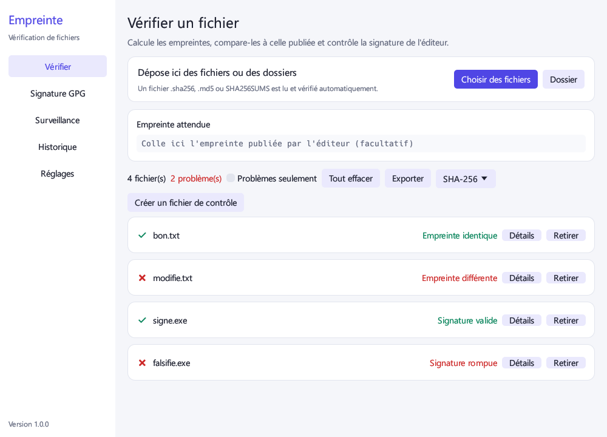

# Empreinte

Application Windows simple pour vérifier un fichier téléchargé : est-il intact, et vient-il bien de l'éditeur annoncé ?



## Fonctionnalités

- **Empreintes :** MD5, SHA-1, SHA-256, SHA-512 et CRC32, en glissant simplement des fichiers ou des dossiers.
- **Comparaison automatique :** colle l'empreinte publiée, l'algorithme est reconnu et le résultat s'affiche aussitôt.
- **Signature Windows :** pour les `.exe`, `.msi` et `.dll`, indique si le fichier est signé, par qui, et s'il a été modifié depuis.
- **Signature GPG :** vérifie un fichier `.sig` ou `.asc` avec la clé publique de l'éditeur.
- **Fichiers de contrôle :** lit et crée les fichiers `.sha256`, `.md5` et `SHA256SUMS`.
- **Surveillance :** vérifie chaque nouveau fichier d'un dossier tant que l'application est ouverte.
- **VirusTotal (facultatif) :** recherche l'empreinte du fichier avec ta propre clé API, uniquement quand tu cliques.
- **Confort :** gros fichiers avec progression et annulation, entrée au clic droit, thème clair ou sombre, historique, export TXT ou CSV.

## Installation

Télécharge `Empreinte.exe` depuis la page **Releases** et lance-le. Aucune installation n'est nécessaire. Il faut Windows 10 ou 11 en 64 bits.

L'application n'a pas de signature de code payante : Windows SmartScreen peut donc afficher un avertissement au premier lancement. Compare l'empreinte SHA-256 du fichier avec celle publiée dans la release.

## Ce qu'un résultat prouve

| Contrôle | Fichier abîmé | Modification volontaire | Identité de l'éditeur |
|---|---|---|---|
| CRC32, MD5, SHA-1 | Oui | Non | Non |
| SHA-256, SHA-512 | Oui | Oui, si l'empreinte vient d'une source sûre | Non |
| Signature Windows valide | Oui | Oui | Oui |
| Signature GPG valide | Oui | Oui | Oui, si l'empreinte de la clé est confirmée |

Un fichier reconnu n'est pas forcément sans danger : ces contrôles ne remplacent pas un antivirus.

## Limites connues

- La révocation des certificats Windows n'est pas contrôlée, car cela demanderait un accès réseau pour chaque fichier.
- Les fichiers signés uniquement par un catalogue Windows apparaissent comme non signés.
- La vérification GPG ne contrôle ni l'expiration ni la révocation de la clé.
- Au clic droit, sélectionner plusieurs fichiers ouvre une fenêtre par fichier. Pour un lot, glisse-les plutôt dans la fenêtre.

## Données et confidentialité

Les réglages et l'historique restent dans `%APPDATA%\Empreinte`. La clé VirusTotal y est chiffrée pour ton compte Windows. Sans clé, l'application n'utilise jamais le réseau. Avec une clé, seule l'empreinte SHA-256 du fichier choisi est envoyée à VirusTotal.

## Compiler le projet

Il faut [Rust](https://rustup.rs) et les outils de compilation C++ de Visual Studio.

```bash
cargo test
```

```bash
cargo build --release
```

Le programme se trouve ensuite dans `target\release\Empreinte.exe`.

Pour publier une version, pousse une étiquette comme `v1.0.0` : GitHub Actions lance les tests, compile le `.exe` et crée la release avec son empreinte SHA-256.

## Licence

[MIT](LICENSE)
